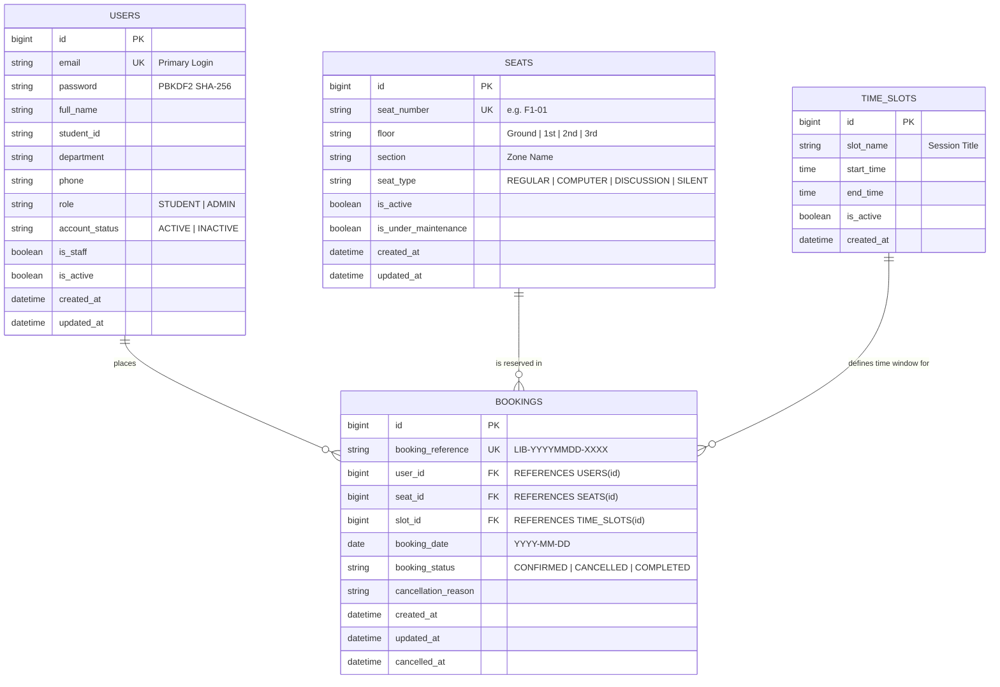

# Entity-Relationship (ER) Diagram

---

## Relationship Cardinalities & Rules

1. **User to Bookings (`1:N`):**
   - One student can make multiple reservations across different dates or distinct non-overlapping time slots.
   - Deleting a user cascade-removes their reservation history.
2. **Seat to Bookings (`1:N`):**
   - A single physical seat can be reserved multiple times across different dates and non-conflicting time slots.
   - Restrict on delete prevents removing physical desk records while active future reservations exist.
3. **TimeSlot to Bookings (`1:N`):**
   - A standardized daily time slot is referenced by multiple seats and bookings.
   - Restrict on delete prevents deleting a time slot while future reservations depend on it.
4. **Cancellation Mechanics:**
   - When a booking's status transitions from `CONFIRMED` to `CANCELLED`, its seat and slot occupancy constraints are immediately released, allowing other students to reserve that desk for that window.
