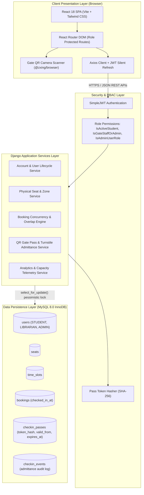
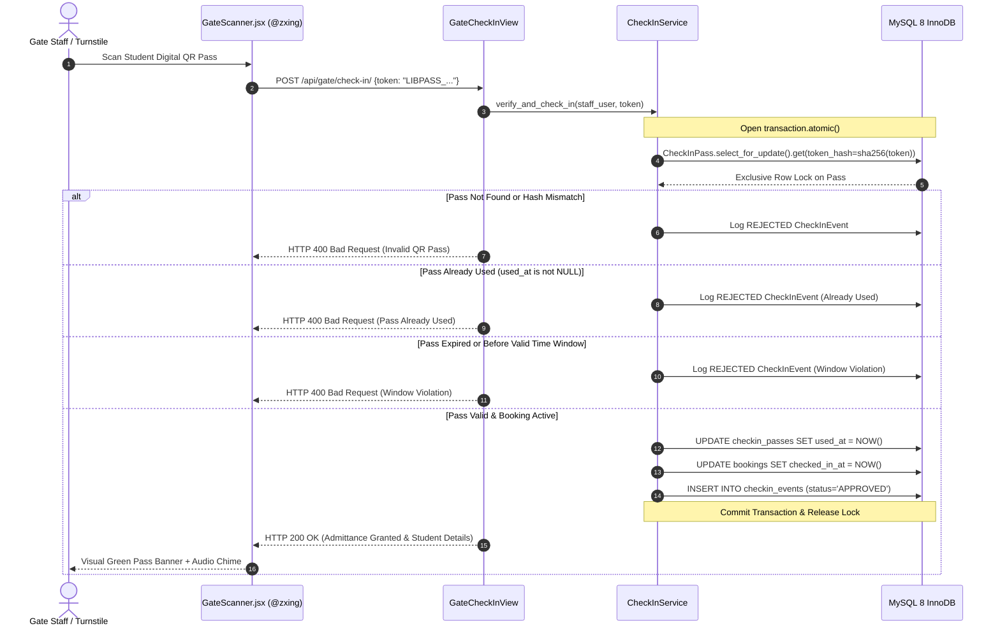

# System Architecture: Smart Digital Library Slot Booking System
## Version 2.0 Architectural Specification

---

## 1. High-Level System Architecture

---

## 2. Core Architectural Upgrades

### 2.1 User Lifecycle & Token Invalidation
- **Single Source of Truth:** `User.account_status` and Django's native `User.is_active` are strictly synchronized via `User.save()`.
- **Token Invalidation:** When an administrator deactivates a user via `PATCH /api/admin/users/{id}/`, setting `account_status='INACTIVE'` immediately flags `is_active=False`. On the student's next request, SimpleJWT's `JWTAuthentication` evaluates `is_active` and rejects the token with HTTP 401.
- **Safety Protections:**
  - Self-deactivation prevention.
  - Self-demotion prevention.
  - Last-admin protection (system prevents deactivating or demoting the only active administrator).

### 2.2 Cryptographic QR Gate Verification Architecture
- **Token Cryptography:**
  - Token string: `LIBPASS_<base64url>` (256 bits of cryptographically secure random entropy via `secrets.token_urlsafe(32)`).
  - Storage: The raw token is NEVER stored in the database. Only its SHA-256 hash (`hashlib.sha256(raw_token.encode()).hexdigest()`) is stored in `checkin_passes.token_hash`.
  - Pass Display: The QR code encodes `LIBPASS_...` and is rendered as a Deep Ink Navy vector data URI using Python's `qrcode[pil]`.
- **Admittance Verification:**
  - Turnstile camera scanner decodes token via `@zxing/browser`.
  - Sent to `POST /api/gate/check-in/`.
  - Transaction opens `transaction.atomic()` with `select_for_update()` on the `CheckInPass` and `Booking` rows.
  - Verifies: Hash match, booking status `CONFIRMED`, `used_at is NULL`, `revoked_at is NULL`, and `valid_from <= now <= expires_at` (with 15-minute early arrival buffer).
  - On approval: Stamps `used_at = now()`, `booking.checked_in_at = now()`, and logs an `APPROVED` admittance event into `checkin_events`.
  - On rejection: Logs a `REJECTED` event with specific audit reason.

---

## 3. QR Gate Verification Sequence Diagram

---

## 4. Contemporary Academic Editorial UI Design System

The application interface follows an **Editorial Academic Design System** tailored to prestigious university research libraries:

| Design Token | Hex Code | Utility Class | Purpose |
|---|---|---|---|
| **Deep Ink Navy** | `#243447` | `bg-ink`, `text-ink` | Navigation bar, major headers, primary actions, QR pass lines |
| **Warm Paper** | `#F5F1E8` | `bg-paper`, `text-paper` | Application background, subtle content containers |
| **Muted Sage** | `#899783` | `bg-sage`, `text-sage` | Available seat indicators, approval banners, librarian accents |
| **Terracotta** | `#B36B50` | `bg-terracotta` | Reserved seats, warning accents, academic section badges |
| **Charcoal** | `#343A3F` | `text-charcoal` | High-contrast body text, readable data rows |
| **Soft Stone** | `#DED9CE` | `border-stone`, `bg-stone/20` | Crisp dividers, subtle card borders, inactive status badges |

- **Typography:**
  - Headings: `Source Serif 4` (`font-serif`) for academic elegance and institutional authority.
  - Body & UI: `DM Sans` (`font-sans`) for clean legibility on data tables and forms.
  - Identifiers: Monospace (`font-mono`) for desk codes, references, and time windows.
